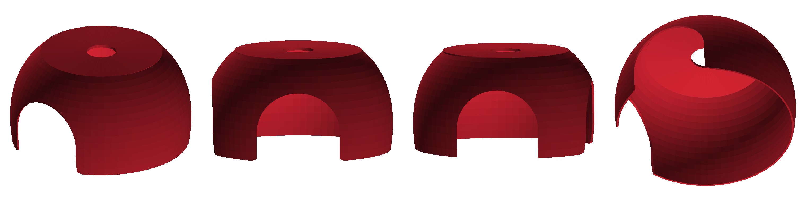
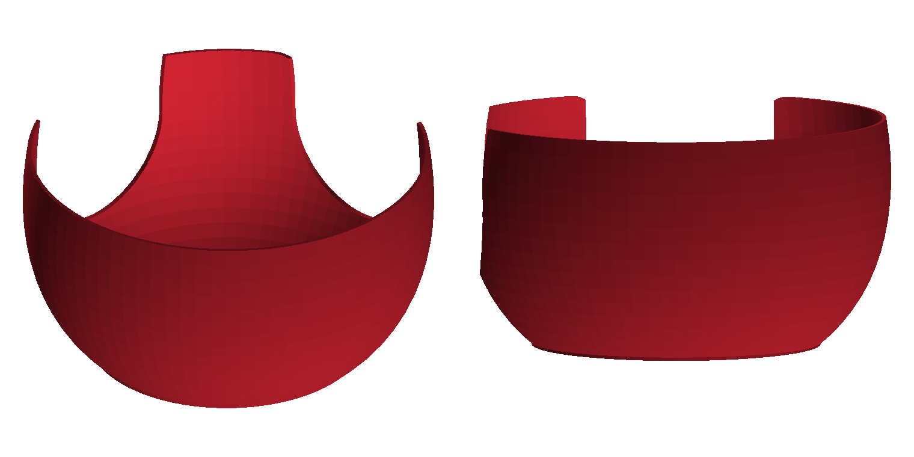
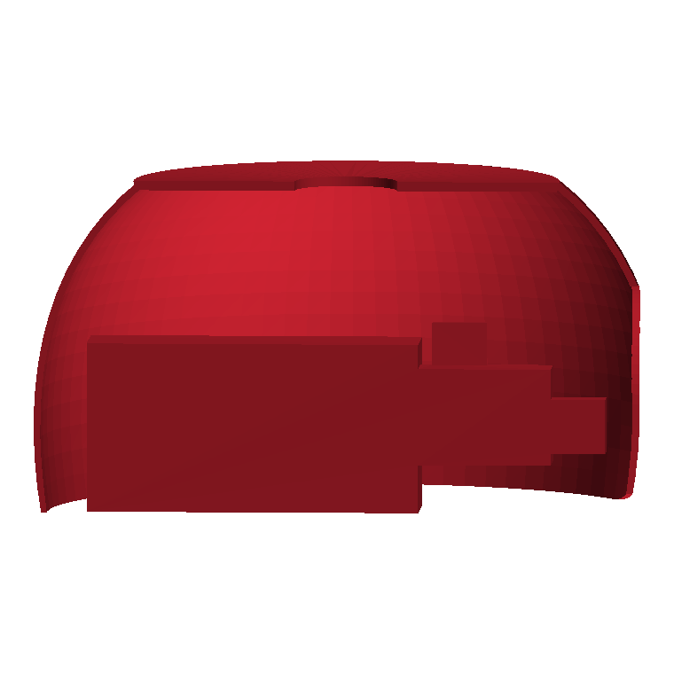
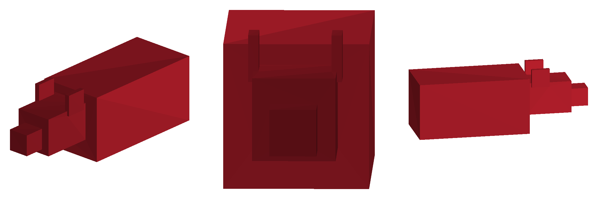

# 糖尿病造模小鼠躲避隔离屋 · 3D 打印 / Mouse Hideout for Diabetic Model Mice (3D printed)

[中文](#中文) ｜ [English](#english)



---

## 中文

**一句话**：一个给糖尿病造模小鼠用的双门躲避屋（hide / 遮蔽窝），罩式结构、底部开放、顶部单孔透气，两个正圆拱门让你从外面就能观察而不必翻窝。

> 本项目是一个 3D 打印的**动物躲避物**，不是生物安全隔离器，不能替代 IVC / 隔离包。

### 规格

| 项目 | 数值 |
|---|---|
| 外形 长 × 宽 × 高 | 100.0 × 100.2 × 55.3 mm |
| 口沿外径 / 内径 | Ø103.5 / Ø99.3 mm |
| 顶部圆盘 / 通风孔 | Ø70.9 / Ø17.0 mm |
| 门（两个，完全相同） | 约 45 宽 × 38 高，直边 16 + 正圆拱 R22 |
| 壁厚 | ≈1.2 mm |
| 体积 / 用料 | 22.1 cm³ ≈ 28 g PLA |
| 网格 | 水密，6,216 面 |
| 底面 | 开放（直接坐在垫料上） |

### 图片

| 成品 | 打印姿态 |
|---|---|
|  |  |

| 与 30 g 小鼠的适配剖面 | 参照用方块鼠（30 g） |
|---|---|
|  |  |

### 设计要点（针对糖尿病造模小鼠）

- **双门**：前后各一个，避免单门被堵死后动物出不来；也便于从任意一侧观察
- **顶部单孔**：透气 + 不积氨，同时挡光形成暗环境（小鼠偏好暗处）
- **底部全开放**：直接坐在垫料上，零死角、好清理、不积尿
- **尺寸留余**：30 g 成鼠（长 86 / 宽 28 / 高 31 mm）装进去，头尾余 6.6 mm、头顶余 23 mm、门通过余 7 mm
- **薄壁可清洗**：1.2 mm 壁厚，75 % 乙醇擦洗不变形；**不可高压灭菌**（会软化变形）

### 打印参数

| 参数 | 值 |
|---|---|
| 材料 | PLA（首选）或 PETG；半透红 PETG 可做"观察窗"效果 |
| 喷嘴 / 层高 | 0.4 mm / 0.2 mm |
| 温度 | 200 / 60 ℃（PLA） |
| 填充 | 20 %（壁厚已实心，填充影响很小） |
| 摆放 | **屋顶贴床、开口朝上**（见 `models/mouse-hideout-100mm-print-ready.stl`） |
| 支撑 | 开，选"仅接触热床"（约 800 mm²，只在最底一圈） |
| 底边 | 5 mm brim |
| 预计 | 约 28 g，1.5 小时 |

> `-print-ready` 是已经摆好的打印姿态；`-house-pose` 是使用姿态（屋顶朝上）。
> 若切片软件里看到"反着的碗"，那就是对的——打出来翻过来就是屋子。

### 使用与清洁

1. 首次使用前用中性洗涤剂清洗、晾干
2. 每周更换垫料时用 75 % 乙醇喷擦、晾干后再放回
3. 不建议使用 121 ℃ 高压蒸汽灭菌（PLA 会变形）；需要灭菌级使用请改用可高温材料并接受形变风险
4. 打印层纹会藏污，建议 0.2 mm 层高、避免 0.3 mm 以上的粗糙表面

### 文件

```
models/
  mouse-hideout-100mm-print-ready.stl     ★ 打印用，已摆好姿态，直接切片
  mouse-hideout-100mm.obj                 原始模型（使用姿态）
images/                                   预览 / 打印姿态 / 剖面 / 方块鼠
```

### 免责声明

本模型为实验动物**环境丰容 / 遮蔽物**，非医疗器械，未做生物相容性认证。使用者需自行确认其符合本机构实验动物伦理（IACUC）与饲养规范。糖尿病造模动物抵抗力弱，请确保打印件清洁、无锐边、无残留支撑。

### 许可

[CC BY-NC 4.0](https://creativecommons.org/licenses/by-nc/4.0/)：可自由分享、修改（署名 + 非商业）。

### 作者

- GitHub：[@Takumiszu](https://github.com/Takumiszu)
- 欢迎提 Issue 反馈尺寸 / 门型需求

---

## English

**TL;DR** — A two-door hideout for diabetic model mice: dome cover, open bottom, one vent hole on top, and two identical round-arched doors so you can observe the animal without lifting the house.

> This is a 3D-printed **animal hide**, not a biological isolator. It is not a substitute for IVC cages or isolator units.

### Specifications

| Item | Value |
|---|---|
| Footprint × Height | 100.0 × 100.2 × 55.3 mm |
| Rim OD / ID | Ø103.5 / Ø99.3 mm |
| Top disc / Vent hole | Ø70.9 / Ø17.0 mm |
| Doors (two, identical) | ≈45 W × 38 H, 16 mm straight + R22 semicircular arch |
| Wall thickness | ≈1.2 mm |
| Volume / Filament | 22.1 cm³ ≈ 28 g PLA |
| Mesh | watertight, 6,216 triangles |
| Bottom | fully open (sits on bedding) |

### Images

| Finished part | Print orientation |
|---|---|
|  |  |

| Fit check with a 30 g mouse | Reference block mouse (30 g) |
|---|---|
|  |  |

### Design notes (for diabetic model mice)

- **Two doors** — if one gets blocked the animal is never trapped; also lets you observe from either side
- **Single top vent** — ventilation and ammonia control, while still keeping the interior dark (mice prefer dark hides)
- **Open bottom** — sits directly on bedding; no dead corners, easy to clean, no urine pooling
- **Sized with margin** — a 30 g adult mouse (86 L × 28 W × 31 H mm) has 6.6 mm front/back, 23 mm headroom, 7 mm door clearance
- **Washable walls** — 1.2 mm wall, survives 75 % ethanol wiping; **do not autoclave** (PLA deforms)

### Print settings

| Setting | Value |
|---|---|
| Material | PLA (recommended) or PETG; translucent red PETG for a "window" look |
| Nozzle / Layer | 0.4 mm / 0.2 mm |
| Temps | 200 / 60 °C (PLA) |
| Infill | 20 % (walls are already solid) |
| Orientation | **roof on the bed, openings up** (`models/mouse-hideout-100mm-print-ready.stl`) |
| Supports | on, "build plate only" (≈800 mm², bottom ring only) |
| Brim | 5 mm |
| Estimate | ≈28 g, ≈1.5 h |

> The `-print-ready` file is already oriented; the `-house-pose` file is how it looks in use.
> If your slicer shows an upside-down bowl, that is correct — flip the printed part over.

### Use & cleaning

1. Wash with mild detergent and dry before first use
2. Wipe with 75 % ethanol weekly when changing bedding; let dry before returning
3. Do **not** autoclave at 121 °C (PLA deforms); if sterility is required, use a high-temp material and accept deformation risk
4. Layer lines trap debris — prefer 0.2 mm layers over 0.3 mm+

### Files

```
models/
  mouse-hideout-100mm-print-ready.stl     ★ print-ready, already oriented, slice directly
  mouse-hideout-100mm.obj                 source model (house pose)
images/                                   preview / print orientation / section / block mouse
```

### Disclaimer

This model is an environmental-enrichment hide, not a medical device; no biocompatibility certification is claimed. Users are responsible for compliance with their institutional IACUC and animal-care regulations. Diabetic animals are immunocompromised — ensure the print is clean, free of sharp edges and support residue.

### License

[CC BY-NC 4.0](https://creativecommons.org/licenses/by-nc/4.0/) — free to share and adapt with attribution, non-commercial.

### Author

- GitHub: [@Takumiszu](https://github.com/Takumiszu)
- Issues with size / door-shape requests are welcome
